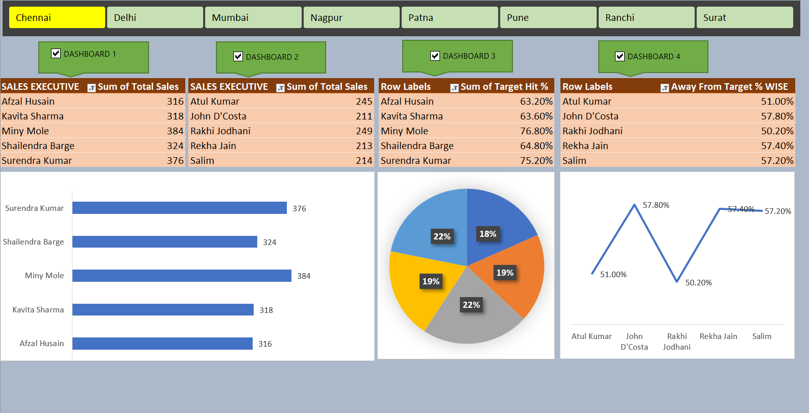

# Excel Sales Dashboard

An interactive sales performance dashboard built in Excel, using only Pivot Tables, on the data of 141 sales executives across 8 regions.

## The Problem
A sales team of 141 people, each with a target of 500 units over 5 days. A manager needs quick answers: who is performing, who is falling behind, and how far is everyone from the target?

## About the Data
- 141 sales executives across 8 regions: Chennai, Delhi, Mumbai, Nagpur, Patna, Pune, Ranchi, Surat
- Daily sales for 5 days (Day 1 to Day 5)
- Fixed target of 500 per executive
- Columns: Total Sales, Target Hit % and Away From Target %

## What the Dashboard Shows
| Dashboard | Question it answers | Chart |
|-----------|---------------------|-------|
| 1 | Who are the top 5 sellers in a region? | Bar chart |
| 2 | Who are the bottom 5 sellers in a region? | Pie chart |
| 3 | How close are the top 5 to the target? | Target Hit % |
| 4 | How far are the bottom 5 from the target? | Line chart |

Click any region button at the top and all four views update together.

## Key Insights
- **Nobody reached the target of 500.** The best result was Jagdish Chandra (Surat) with 389 units, which is 77.8% of target.
- The lowest was Omprakash O (Mumbai) with 143 units (28.6%). That is a gap of 246 units between best and worst.
- Every region has its own star performer, from Miny Mole in Chennai (384) to Jagdish Chandra in Surat (389).
- Weakest performers are spread across regions, so the problem is individual performance, not one weak city.

## Top and Bottom Performer by Region
| Region | Top performer | Bottom performer |
|--------|---------------|------------------|
| Chennai | Miny Mole (384) | John D'Costa (211) |
| Delhi | Anikuttan (382) | Praveen Kumar (166) |
| Mumbai | Kahkasha Parveen / Mukesh Nagar (351) | Omprakash O (143) |
| Nagpur | Arvind Sharma (379) | Renu Pratap (206) |
| Patna | Janardan Mishra (355) | Raji Abraham (189) |
| Pune | Shubhanjali Joshi (367) | Dinesh Kumar (166) |
| Ranchi | Syed Saqib (369) | Pankaj Shelkey (156) |
| Surat | Jagdish Chandra (389) | Sheena Joseph / Arun Kumar (183) |

## How I Built It
The whole dashboard runs on Pivot Tables and Pivot Charts, with slicers for region filtering. No complex formulas in the dashboard itself. Each view is a pivot with a Top 5 or Bottom 5 filter on Total Sales.

## What I Learned
This project taught me how to turn 141 rows of raw data into something a manager can read in 10 seconds. Pivot Tables are much more powerful than I thought.

## File
[Chapter - 10 - DASHBOARD PROJECT.xlsm](./Chapter%20-%2010%20-%20DASHBOARD%20PROJECT.xlsm): raw data sheet plus dashboard sheet.
