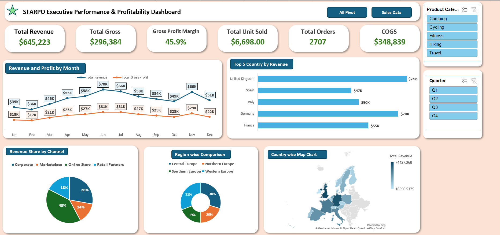

# STARPO Executive Sales & Profitability Dashboard

An Excel dashboard that shows where a European outdoor-gear brand makes its revenue and profit, by country, channel, region and month.

> **Note:** STARPO is a fictional company and the data is dummy data. I built this by following the Satish Dhawale YouTube tutorial. I then checked the formulas and wrote up the findings myself. [[VIDEO LINK](https://youtu.be/9ZQGrKK_PTI?si=fq15mr5GVs4qgdx4)]



## Business Problem

A sales head needs one screen that answers:

- How much revenue and gross profit did we make, and at what margin?
- Which countries, channels and regions bring the most sales?
- Which months are strong and which are weak?

## Dataset

- 2,707 orders from 01-Jan-2026 to 31-Dec-2026
- 4 regions, 16 countries, 4 sales channels
- 5 product categories: Camping, Cycling, Fitness, Hiking, Travel
- Dummy data, no real customers

| Column | Meaning |
|---|---|
| ID, Order Date | Order number and date |
| Region, Country | Where the order was sold |
| Sales Channel | Online Store, Corporate, Retail Partners, Marketplace |
| Customer Type | New, Returning, Business (as given in the data) |
| Product Category, Product | What was sold |
| Units Sold, Unit Price, Discount %, Unit Cost | Order inputs |
| Revenue | Units x Unit Price x (1 - Discount) |
| COGS | Units x Unit Cost |
| Gross Profit | Revenue - COGS |
| GP Margin % | Gross Profit / Revenue |
| Year2, Quarter2, MonthNo, Month2 | Helper columns I added so the slicers work |

## Tools

Excel: PivotTables, Slicers, PivotCharts, Map Chart, formulas

## Data Cleaning

- Checked the Revenue, COGS and Gross Profit formulas on sample rows. They were correct.
- Added helper columns for year, quarter and month, so I could build slicers.
- [ADD HERE: nulls, duplicates, date or text fixes you actually did]

## Approach

1. Built 10 PivotTables, one for each KPI and chart.
2. Connected the Product Category and Quarter slicers to all of them.
3. Built the dashboard with 6 KPI cards, a line chart, a bar chart, a pie chart, a donut chart and a map.

## Key Insights

- Revenue was **$645,223**, gross profit **$296,384** and gross margin **45.9%**.
- Average order value was about **$238** (645,223 / 2,707 orders).
- The UK ($74K) and Germany ($70K) are the top two countries. The top 5 countries bring about **46%** of all revenue.
- Online Store is the biggest channel with **$260K (about 40%)**. Corporate is second with $180K.
- Western Europe ($198K) and Central Europe ($191K) are close. Southern Europe is the lowest at $125K.
- Revenue peaked in June ($70K) and was lowest in February ($36K). November was a second peak ($66K).

## Recommendations

- Plan stock and marketing before the June and November peaks.
- Look for ways to lift sales in February.

## Project Structure

```
STARPO-Sales-Dashboard/
├── README.md
├── STARPO_Sales_Dashboard.xlsx
└── Dashboard_image.png
```

## Limitations & Future Scope

- This is dummy data, so the findings are practice findings and not real business results.
- Customer Type overlaps with the Corporate channel, so I did not use it for analysis.
- No forecasting and no SQL in this version.
- Next, I want to rebuild this in Power BI and run the same analysis in SQL.

## About Me

Pushp Raj | BBA (Marketing), Amity University Patna | Google Data Analytics certified

[GitHub: Pushp-raj-07](https://github.com/Pushp-raj-07) | Email: pushprajput223@gmail.com
