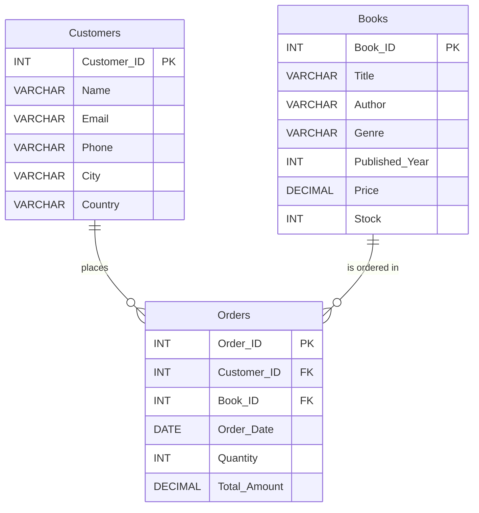

# 📚 Online Bookstore Sales Analysis (MySQL)
## ❓ Project Questions

The 20 questions this project answers (11 basic, 9 advanced):


---

## 📌 Project Overview

This project analyses a 3-table online bookstore database in MySQL. I built the schema, loaded the CSV data, and wrote **20 SQL queries** (11 basic and 9 advanced) to answer practical questions about sales, customers and inventory.

Every query below is documented with its business purpose, the SQL, the concept used, the real result and, where the data supports it, a short insight. Result sets are exported to the `Results/` folder.

**Tools:** MySQL, MySQL Workbench, Excel/CSV, GitHub

> **Note on data:** The dataset is publicly available dummy/synthetic data, so findings are for practice and not real business conclusions. The SQL queries and analysis in this repository are my own work.

---

## 🗂️ Dataset

Database name: `OnlineBookstore` (3 tables, 500 rows each)

| Table | Rows | Columns |
|---|---|---|
| `Books` | 500 | Book_ID, Title, Author, Genre, Published_Year, Price, Stock |
| `Customers` | 500 | Customer_ID, Name, Email, Phone, City, Country |
| `Orders` | 500 | Order_ID, Customer_ID, Book_ID, Order_Date, Quantity, Total_Amount |

- **Order dates:** 2022-12-09 to 2024-12-07
- **Genres (7):** Biography, Fantasy, Non-Fiction, Fiction, Romance, Science Fiction, Mystery

---

## 🔗 ER Relationships

| Child table | Foreign key | Parent table | Primary key |
|---|---|---|---|
| `Orders` | `Customer_ID` | `Customers` | `Customer_ID` |
| `Orders` | `Book_ID` | `Books` | `Book_ID` |



---

## 🛠️ Database Setup

**1. Create the database and tables**

```sql
CREATE DATABASE OnlineBookstore;
USE OnlineBookstore;

CREATE TABLE Books (
    Book_ID INT AUTO_INCREMENT PRIMARY KEY,
    Title VARCHAR(100), Author VARCHAR(100), Genre VARCHAR(50),
    Published_Year INT, Price DECIMAL(10, 2), Stock INT
);
CREATE TABLE Customers (
    Customer_ID INT AUTO_INCREMENT PRIMARY KEY,
    Name VARCHAR(100), Email VARCHAR(100), Phone VARCHAR(15),
    City VARCHAR(50), Country VARCHAR(150)
);
CREATE TABLE Orders (
    Order_ID INT AUTO_INCREMENT PRIMARY KEY,
    Customer_ID INT, Book_ID INT, Order_Date DATE,
    Quantity INT, Total_Amount DECIMAL(10, 2),
    FOREIGN KEY (Customer_ID) REFERENCES Customers(Customer_ID),
    FOREIGN KEY (Book_ID) REFERENCES Books(Book_ID)
);
```

**2. Load the CSV files** (example for `Books`; the same pattern is used for `Customers` and `Orders`, with the matching column list)

```sql
LOAD DATA LOCAL INFILE 'path/to/Data/Books.csv'
INTO TABLE Books
FIELDS TERMINATED BY ','
OPTIONALLY ENCLOSED BY '"'
LINES TERMINATED BY '\r\n'
IGNORE 1 ROWS
(Book_ID, Title, Author, Genre, Published_Year, Price, Stock);
```

**3. Verify the load**

```sql
SELECT COUNT(*) FROM Orders;
```

Result: **500 rows**.

---

## 🟢 Basic Queries (11)

### Basic Q1: Fiction books

**Question:** Retrieve all books in the "Fiction" genre.

**Business purpose:** Lets the catalogue team review one genre's titles quickly.

```sql
-- 1) Retrieve all books in the "Fiction" genre
SELECT * FROM Books WHERE Genre = 'Fiction';
```

**Approach / concept used:** Row filtering with `WHERE` and an equality condition.

**Result:** 60 Fiction books.

**Insight:** Fiction is the lowest genre in both units sold (225) and revenue ($7,271.22). See Advanced Q1.

📄 [Results/Basic Queries 1.csv](Results/Basic%20Queries%201.csv)

---

### Basic Q2: Books published after 1950

**Question:** Find books published after the year 1950.

**Business purpose:** Separates newer titles from older ones in the catalogue.

```sql
-- 2) Find books published after the year 1950
SELECT * FROM Books WHERE Published_Year > 1950;
```

**Approach / concept used:** Numeric comparison in `WHERE` using `>`.

**Result:** 292 of 500 books were published after 1950.

**Insight:** More than half of the catalogue is post-1950.

📄 [Results/Basic Queries 2.csv](Results/Basic%20Queries%202.csv)

---

### Basic Q3: Customers from Canada

**Question:** List all customers from Canada.

**Business purpose:** Identifies customers in a specific country for regional analysis.

```sql
-- 3) List all customers from Canada
SELECT * FROM Customers WHERE Country = 'Canada';
```

**Approach / concept used:** Text filtering with `WHERE` on the `Country` column.

**Result:** 3 Canadian customers (Customer_IDs 38, 415 and 468).

**Insight:** Canada is a very small segment of the 500 customers in this dataset.

📄 [Results/Basic Queries 3.csv](Results/Basic%20Queries%203.csv)

---

### Basic Q4: Orders in November 2023

**Question:** Show orders placed in November 2023.

**Business purpose:** Supports monthly sales reporting.

```sql
-- 4) Show orders placed in November 2023
SELECT * FROM Orders WHERE Order_Date BETWEEN '2023-11-01' AND '2023-11-30';
```

**Approach / concept used:** Date range filtering with `BETWEEN`.

**Result:** 25 orders were placed in November 2023.

> **Refinement:** `Order_Date` is a `DATE` column here, so `BETWEEN` works correctly. If the column were `DATETIME`, orders on `2023-11-30` after midnight would be missed. A safer pattern for that case is
> `WHERE Order_Date >= '2023-11-01' AND Order_Date < '2023-12-01'`.

📄 [Results/Basic Queries 4.csv](Results/Basic%20Queries%204.csv)

---

### Basic Q5: Total stock available

**Question:** Retrieve the total stock of books available.

**Business purpose:** Gives a quick view of total inventory on hand.

```sql
-- 5) Retrieve the total stock of books available
SELECT SUM(Stock) AS Total_Stock FROM Books;
```

**Approach / concept used:** Aggregation with `SUM()` and a column alias.

**Result:** Total stock = **25,056** units.

📄 [Results/Basic Queries 5.csv](Results/Basic%20Queries%205.csv)

---

### Basic Q6: Most expensive book

**Question:** Find the details of the most expensive book.

**Business purpose:** Identifies the top price point in the catalogue.

```sql
-- 6) Find the details of the most expensive book
SELECT * FROM Books ORDER BY Price DESC LIMIT 1;
```

**Approach / concept used:** Sorting with `ORDER BY ... DESC` and `LIMIT 1`.

**Result:** "Proactive system-worthy orchestration" by Robert Scott (Mystery), priced at **$49.98**.

📄 [Results/Basic Queries 6.csv](Results/Basic%20Queries%206.csv)

---

### Basic Q7: Customers who ordered more than 1 copy

**Question:** Show all customers who ordered more than 1 quantity of a book.

**Business purpose:** Finds customers who buy multiple copies, useful for bulk or gift-buyer analysis.

```sql
-- 7) Show all customers who ordered more than 1 quantity of a book
SELECT DISTINCT c.* FROM Customers c
JOIN Orders o ON c.Customer_ID = o.Customer_ID
WHERE o.Quantity > 1;
```

**Approach / concept used:** `JOIN` between `Customers` and `Orders`, with `DISTINCT` so each customer appears once.

**Result:** 281 customers.

**Insight:** 307 customers placed orders in total, so most buyers (281 of 307) have bought more than one copy in at least one order.

📄 [Results/Basic Queries 7.csv](Results/Basic%20Queries%207.csv)

---

### Basic Q8: Orders above $20

**Question:** Retrieve all orders where the total amount exceeds $20.

**Business purpose:** Shows how many orders clear a minimum value threshold.

```sql
-- 8) Retrieve all orders where the total amount exceeds $20
SELECT * FROM Orders WHERE Total_Amount > 20;
```

**Approach / concept used:** Numeric filtering on `Total_Amount`.

**Result:** 473 of 500 orders are above $20.

**Insight:** The large majority of orders are above $20.

📄 [Results/Basic Queries 8.csv](Results/Basic%20Queries%208.csv)

---

### Basic Q9: Genres available

**Question:** List all genres available in the Books table.

**Business purpose:** Confirms the product categories before grouping or reporting by genre.

```sql
-- 9) List all genres available in the Books table
SELECT DISTINCT Genre FROM Books;
```

**Approach / concept used:** `DISTINCT` to remove duplicate values.

**Result:** 7 genres: Biography, Fantasy, Non-Fiction, Fiction, Romance, Science Fiction and Mystery.

📄 [Results/Basic Queries 9.csv](Results/Basic%20Queries%209.csv)

---

### Basic Q10: Book with the lowest stock

**Question:** Find the book with the lowest stock.

**Business purpose:** Flags titles that may need restocking.

```sql
-- 10) Find the book with the lowest stock
SELECT * FROM Books ORDER BY Stock ASC LIMIT 1;
```

**Approach / concept used:** Sorting with `ORDER BY ... ASC` and `LIMIT 1`.

**Result:** "Networked systemic implementation" (Book_ID 44) has a stock of **0**.

> **Refinement:** 5 books have 0 stock (Book_IDs 44, 60, 127, 163 and 378), and `LIMIT 1` shows only one of them. A tie-safe version returns all of them:
>
> ```sql
> SELECT * FROM Books
> WHERE Stock = (SELECT MIN(Stock) FROM Books);
> ```

**Insight:** 5 titles are completely out of stock.

📄 [Results/Basic Queries 10.csv](Results/Basic%20Queries%2010.csv)

---

### Basic Q11: Total revenue

**Question:** Calculate the total revenue generated from all orders.

**Business purpose:** Provides the headline sales figure for the business.

```sql
-- 11) Calculate the total revenue generated from all orders
SELECT SUM(Total_Amount) AS Total_Revenue FROM Orders;
```

**Approach / concept used:** Aggregation with `SUM()` on `Total_Amount`.

**Result:** Total revenue = **$75,628.66**.

**Insight:** This comes from 500 orders covering 2,697 books sold.

📄 [Results/Basic Queries 11.csv](Results/Basic%20Queries%2011.csv)

---

## 🔵 Advanced Queries (9)

### Advanced Q1: Books sold per genre

**Question:** Retrieve the total number of books sold for each genre.

**Business purpose:** Shows which genres drive unit sales.

```sql
-- 1) Total number of books sold for each genre
SELECT b.Genre, SUM(o.Quantity) AS Total_Books_Sold
FROM Orders o JOIN Books b ON o.Book_ID = b.Book_ID
GROUP BY b.Genre;
```

**Approach / concept used:** `JOIN` to bring genre from `Books` into `Orders`, then `GROUP BY` with `SUM()`.

**Result:**

| Genre | Total books sold |
|---|---|
| Mystery | 504 |
| Science Fiction | 447 |
| Fantasy | 446 |
| Romance | 439 |
| Non-Fiction | 351 |
| Biography | 285 |
| Fiction | 225 |

**Insight:** Mystery leads in units and Fiction is the lowest. The seven genres add up to 2,697 books sold.

📄 [Results/Advance Queries 1.csv](Results/Advance%20Queries%201.csv)

---

### Advanced Q2: Average price of Fantasy books

**Question:** Find the average price of books in the "Fantasy" genre.

**Business purpose:** Helps compare one genre's pricing against the rest of the store.

```sql
-- 2) Average price of books in the "Fantasy" genre
SELECT AVG(Price) AS Average_Price FROM Books WHERE Genre = 'Fantasy';
```

**Approach / concept used:** `AVG()` combined with a `WHERE` filter.

**Result:** Fantasy average price = **$25.98** (store-wide average is about $27.37).

**Insight:** Fantasy books are priced slightly below the store average.

📄 [Results/Advance Queries 2.csv](Results/Advance%20Queries%202.csv)

---

### Advanced Q3: Customers with at least 2 orders

**Question:** List customers who have placed at least 2 orders.

**Business purpose:** Identifies repeat customers.

```sql
-- 3) Customers who have placed at least 2 orders
SELECT o.Customer_ID, c.Name, COUNT(o.Order_ID) AS Order_Count
FROM Orders o JOIN Customers c ON o.Customer_ID = c.Customer_ID
GROUP BY o.Customer_ID, c.Name
HAVING COUNT(o.Order_ID) >= 2;
```

**Approach / concept used:** `GROUP BY` per customer, then `HAVING` to filter on the aggregated count. `HAVING` is used because the condition applies to groups, not individual rows.

**Result:** 139 customers placed at least 2 orders, out of 307 customers who ordered.

**Insight:** 139 of the 307 customers who ordered are repeat buyers.

📄 [Results/Advance Queries 3.csv](Results/Advance%20Queries%203.csv)

---

### Advanced Q4: Most frequently ordered book

**Question:** Find the most frequently ordered book.

**Business purpose:** Identifies the title with the most order activity.

```sql
-- 4) Most frequently ordered book
SELECT o.Book_ID, b.Title, COUNT(o.Order_ID) AS Order_Count
FROM Orders o JOIN Books b ON o.Book_ID = b.Book_ID
GROUP BY o.Book_ID, b.Title
ORDER BY Order_Count DESC LIMIT 1;
```

**Approach / concept used:** `JOIN`, `GROUP BY` with `COUNT()`, then `ORDER BY ... DESC` with `LIMIT 1`.

**Result:** "Implemented encompassing conglomeration" (Book_ID 31) with **4 orders**.

> **Refinement:** 7 books tie at 4 orders, so `LIMIT 1` shows only one of them. A tie-safe version using a CTE (MySQL 8.0+) returns all tied books:
>
> ```sql
> WITH book_orders AS (
>     SELECT o.Book_ID, b.Title, COUNT(o.Order_ID) AS Order_Count
>     FROM Orders o JOIN Books b ON o.Book_ID = b.Book_ID
>     GROUP BY o.Book_ID, b.Title
> )
> SELECT * FROM book_orders
> WHERE Order_Count = (SELECT MAX(Order_Count) FROM book_orders);
> ```

**Insight:** No single book dominates order frequency, since 7 books share the top count of 4.

📄 [Results/Advance Queries 4.csv](Results/Advance%20Queries%204.csv)

---

### Advanced Q5: Top 3 most expensive Fantasy books

**Question:** Show the top 3 most expensive books of the "Fantasy" genre.

**Business purpose:** Highlights premium titles within one genre.

```sql
-- 5) Top 3 most expensive books of the "Fantasy" genre
SELECT * FROM Books WHERE Genre = 'Fantasy' ORDER BY Price DESC LIMIT 3;
```

**Approach / concept used:** `WHERE` filter, `ORDER BY ... DESC` and `LIMIT 3`.

**Result:**

| Price | Title | Author | Year |
|---|---|---|---|
| $49.90 | Stand-alone content-based hub | Lisa Ellis | 1957 |
| $49.23 | Innovative 3rdgeneration database | Allison Contreras | 1988 |
| $48.97 | Optimized even-keeled analyzer | Sherri Griffith | 1975 |

📄 [Results/Advance Queries 5.csv](Results/Advance%20Queries%205.csv)

---

### Advanced Q6: Total quantity sold by author

**Question:** Retrieve the total quantity of books sold by each author.

**Business purpose:** Shows which authors contribute most to sales.

```sql
-- 6) Total quantity of books sold by each author
SELECT b.Author, SUM(o.Quantity) AS Total_Books_Sold
FROM Orders o JOIN Books b ON o.Book_ID = b.Book_ID
GROUP BY b.Author;
```

**Approach / concept used:** `JOIN` with `GROUP BY` on author and `SUM()` of quantity.

**Result:** 314 authors in the output. Top 5:

| Author | Books sold |
|---|---|
| Patrick Contreras | 28 |
| Melissa Taylor | 27 |
| Thomas Trujillo | 24 |
| Emily James | 24 |
| Valerie Moore | 23 |

**Insight:** Sales are spread across many authors. The top author accounts for 28 of 2,697 units sold.

📄 [Results/Advance Queries 6.csv](Results/Advance%20Queries%206.csv)

---

### Advanced Q7: Cities of customers who spent over $30

**Question:** List the cities where customers who spent over $30 are located.

**Business purpose:** Shows where higher-value orders come from geographically.

```sql
-- 7) Cities where customers who spent over $30 are located
SELECT DISTINCT c.City
FROM Orders o JOIN Customers c ON o.Customer_ID = c.Customer_ID
WHERE o.Total_Amount > 30;
```

**Approach / concept used:** `JOIN` plus `WHERE` on `Total_Amount`, with `DISTINCT` to list each city once.

**Result:** 283 cities.

> **Refinement:** My query checks each *single order* above $30 (`WHERE` filters rows). If "spent over $30" means a customer's *total spend*, the correct pattern groups first and filters the groups with `HAVING`:
>
> ```sql
> SELECT DISTINCT c.City
> FROM Customers c
> JOIN Orders o ON c.Customer_ID = o.Customer_ID
> GROUP BY c.Customer_ID, c.City
> HAVING SUM(o.Total_Amount) > 30;
> ```
>
> This version returns **284 cities** instead of 283. **WHERE vs HAVING:** `WHERE` filters individual rows before grouping; `HAVING` filters groups after aggregation.

📄 [Results/Advance Queries 7.csv](Results/Advance%20Queries%207.csv)

---

### Advanced Q8: Highest-spending customer

**Question:** Find the customer who spent the most on orders.

**Business purpose:** Identifies the most valuable customer and checks revenue concentration.

```sql
-- 8) Customer who spent the most on orders
SELECT c.Customer_ID, c.Name, SUM(o.Total_Amount) AS Total_Spent
FROM Orders o JOIN Customers c ON o.Customer_ID = c.Customer_ID
GROUP BY c.Customer_ID, c.Name
ORDER BY Total_Spent DESC LIMIT 1;
```

**Approach / concept used:** `JOIN`, `GROUP BY` per customer, `SUM()`, then `ORDER BY ... DESC` with `LIMIT 1`.

**Result:** Kim Turner (Customer_ID 457) spent **$1,398.90**, about 1.85% of total revenue. Next highest: Customer_ID 174 ($1,080.95) and Customer_ID 364 ($1,052.27).

**Insight:** Revenue is not concentrated in one customer. No customer exceeds 2% of total revenue.

📄 [Results/Advance Queries 8.csv](Results/Advance%20Queries%208.csv)

---

### Advanced Q9: Stock remaining after fulfilling all orders

**Question:** Calculate the stock remaining after fulfilling all orders.

**Business purpose:** Reconciles inventory against orders to spot oversold titles.

```sql
-- 9) Stock remaining after fulfilling all orders
SELECT b.Book_ID, b.Title, b.Stock,
       COALESCE(SUM(o.Quantity), 0) AS Order_Quantity,
       b.Stock - COALESCE(SUM(o.Quantity), 0) AS Remaining_Stock
FROM Books b LEFT JOIN Orders o ON b.Book_ID = o.Book_ID
GROUP BY b.Book_ID, b.Title, b.Stock;
```

**Approach / concept used:** `LEFT JOIN` keeps every book, including books with no orders. `COALESCE` converts the missing order total to 0 so the subtraction works.

**Result:** 500 rows (one per book). **30 books have negative remaining stock.** The worst case is Book_ID 491, "Pre-emptive intangible adapter": stock 2, ordered 20, remaining **-18**.

**Insight:** 30 titles were ordered beyond their available stock, which is a clear inventory risk. Together with the 5 zero-stock titles from Basic Q10, this points to a stock-planning issue in the data.

📄 [Results/Advance Queries 9.csv](Results/Advance%20Queries%209.csv)

---

## 💡 Key Business Insights

**Headline numbers**

| Metric | Value |
|---|---|
| Orders | 500 |
| Books sold | 2,697 |
| Total revenue | $75,628.66 |
| Customers who placed orders | 307 |
| Distinct books ordered | 317 |
| Order date range | 2022-12-09 to 2024-12-07 |

**Genre performance**

| Genre | Revenue | Books sold |
|---|---|---|
| Romance | $13,086.98 | 439 |
| Mystery | $12,788.45 | 504 |
| Science Fiction | $11,770.51 | 447 |
| Non-Fiction | $11,603.06 | 351 |
| Fantasy | $11,238.38 | 446 |
| Biography | $7,870.06 | 285 |
| Fiction | $7,271.22 | 225 |

**What the data shows**

1. **Mystery leads in units (504), Romance leads in revenue ($13,086.98).** Romance sells fewer units than Mystery but earns more, so each Romance sale brings in more revenue on average.
2. **Fiction is the weakest genre** in both units sold and revenue.
3. **Revenue is well spread.** 307 customers placed orders, and no customer exceeds 2% of total revenue (the top customer is about 1.85%).
4. **Repeat buying is common.** 139 of 307 buying customers placed at least 2 orders.
5. **Catalogue reach is partial.** Only 317 of the 500 books were ordered at least once.
6. **Inventory risk.** 30 titles are oversold (negative remaining stock) and 5 titles have zero stock.

> Because the dataset is synthetic, these findings demonstrate the analysis process and are not conclusions about a real business.

---

## 🧰 SQL Skills Demonstrated

| Skill | Where used |
|---|---|
| Database design: tables, primary keys, foreign keys | Database Setup |
| Data loading and validation (`LOAD DATA LOCAL INFILE`, `COUNT(*)`) | Database Setup |
| Filtering with `WHERE`, comparison operators, `BETWEEN` | Basic Q1, Q2, Q3, Q4, Q8 |
| Aggregate functions (`SUM`, `AVG`, `COUNT`) | Basic Q5, Q11; Advanced Q1, Q2, Q3, Q4, Q6, Q8 |
| Sorting and `LIMIT` | Basic Q6, Q10; Advanced Q4, Q5, Q8 |
| `DISTINCT` | Basic Q7, Q9; Advanced Q7 |
| `INNER JOIN` across tables | Basic Q7; Advanced Q1, Q3, Q4, Q6, Q7, Q8 |
| `GROUP BY` | Advanced Q1, Q3, Q4, Q6, Q8, Q9 |
| `HAVING` (filtering groups) | Advanced Q3; Advanced Q7 refinement |
| `LEFT JOIN` with `COALESCE` | Advanced Q9 |
| Subqueries and CTEs (tie-safe refinements) | Basic Q10 and Advanced Q4 refinements |

---

## 📁 Repository Structure

```
SQL/
├── README.md
└── Online-Bookstore-Sales-Analysis/
    ├── README.md
    ├── Bookstore_Queries.sql
    ├── Basic_Queries Questions.png      (the 11 basic questions)
    ├── Advance_Queries Questions.png    (the 9 advanced questions)
    ├── Data/                    (Books.csv, Customers.csv, Orders.csv)
    └── Results/                 (Basic Queries 1–11.csv, Advance Queries 1–9.csv)
```

---

## ▶️ How to Run

1. Install MySQL and MySQL Workbench (MySQL 8.0 or later is needed for the CTE refinement in Advanced Q4).
2. Clone this repository and open `Bookstore_Queries.sql` in Workbench.
3. Enable local file loading: run `SET GLOBAL local_infile = 1;` and make sure your connection allows `LOCAL INFILE` (in Workbench, add `OPT_LOCAL_INFILE=1` under the connection's Advanced tab).
4. Run the `CREATE DATABASE` and `CREATE TABLE` statements from the Database Setup section.
5. Update the file paths in the `LOAD DATA LOCAL INFILE` statements so they point to the CSV files in the `Data/` folder.
6. Check the load with `SELECT COUNT(*) FROM Orders;`. It should return 500.
7. Run the basic and advanced queries and compare your output with the files in `Results/`.

---

## 👤 Author

**Pushp Raj**
BBA (Marketing), Amity University Patna | Patna, India

Fresher building Data Analytics skills in Excel, SQL and Power BI through hands-on projects. See my other work in the main [Data-Analytics-Portfolio](../../README.md).
